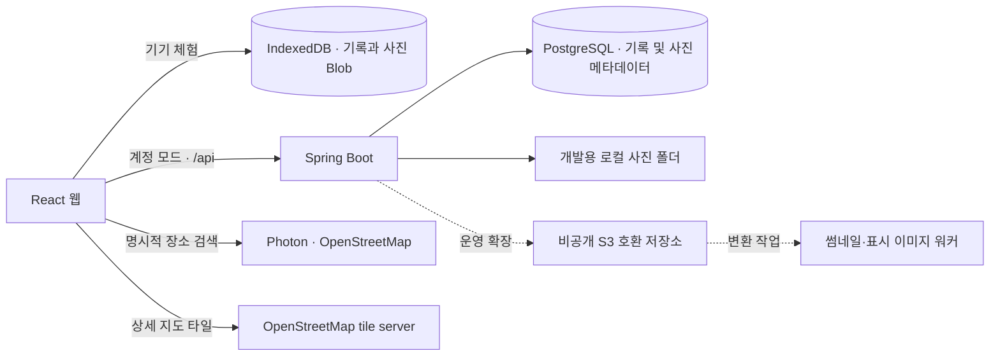

# 채움도 시스템 명세

기준: [원본 PRD](docs/PRD.md), 사용자 제공 `UI.pdf`, 후속 계정 구현 요청. PRD 원문은 보존한다. 이 파일은 합의된 제품·기술 결정을 기록하며, 후속 사용자 요청이 원문 MVP 제외 항목보다 우선한다.

## 1. 제품과 범위

국내 여행을 기록할수록 사진으로 채워지는 개인 여행 지도. React + TypeScript 프론트엔드, Java 21 + Spring Boot 4.1.1 백엔드, PostgreSQL 17을 사용한다.

- 지도와 MY 두 탭. 기록 추가는 지도에서 시작한다.
- 지도는 실제 행정 경계 기반의 정적 SVG다. 17개 시·도와 250개 시·군·구 경계를 탐색하고 시·군·구 안에서 3,627개 행정 읍·면·동을 목록으로 선택한다. 지도의 단위와 출처는 [지도 결정](docs/MAP.md)에 기록한다.
- 새 기록 하나는 이동 순서대로 최대 10개 읍·면·동 또는 시·군·구와 대표 사진 한 장에 연결된다. 읍·면·동 기록은 상위 시·군·구·시도에 자동 합산한다. 첫 지역을 대표 지역으로 유지해 기존 조회·정렬과 호환하고, 연결된 모든 지역에서 같은 기록을 다시 열 수 있다. 기존 시·도·시군구 기록도 호환한다. DAY별 각 방문 장소에는 사진 한 장과 검색으로 선택한 좌표를 선택적으로 연결할 수 있다.
- 필수: 지역, 대표 사진, 시작일, 종료일. 선택: 동행인, DAY별 장소와 장소 사진.
- 방문 > 추천 미방문 > 일반 미방문. 방문 여부는 저장 기록에서 파생한다.
- 지역 대표 사진은 시작일이 가장 최근인 기록의 사진. 시작일 동률이면 생성 시각 순이다.
- 날짜는 시간대 없는 DATE. 포함 일수 = 종료일 − 시작일 + 1. 당일은 1일, 겹치는 여행도 각각 합산한다.
- 장소 입력은 한 줄에 한 장소. 날짜 범위를 줄여도 폼을 닫기 전에는 기존 DAY 입력을 메모리에 유지하며, 저장 시 현재 기간만 보낸다.
- 정적 추천: 강원, 부산, 제주. 추천 설명은 코드/지역 초기 데이터로 관리한다.
- MY는 250개 시·군·구 기준 전국 채움률, 현재 연도 신규 방문 지역, 최다 방문 지역과 17개 시·도별 진행률을 여행 기록에서 파생한다.
- 회원가입, 로그인, 아이디 찾기, 비밀번호 변경, 로그아웃, 계정 삭제를 제공한다. 소셜 로그인, AI, GPS 추적은 제외한다.

## 2. 실행 구조



첫 화면은 로그인이다. 기기 체험 모드는 IndexedDB에 원본 사진 Blob과 기록을 저장한다. 계정 모드는 별도 저장 공간이며 두 모드 간 자동 이관은 구현하지 않는다. 브라우저 데이터 삭제 시 체험 기록은 사라진다.

계정 모드는 PostgreSQL과 로컬 디스크 사진 저장을 실제 사용한다. 세션은 임의 토큰을 HttpOnly·SameSite=Strict 쿠키(`traveler`, 경로 `/api`, 30일)에 두고 DB `traveler_session`에는 기기별로 SHA-256 해시 한 행씩만 저장한다. 그래서 한 계정이 여러 기기에서 동시에 로그인해 있을 수 있다. 서버도 30일 만료(`expires_at`)를 검사하므로 쿠키를 기한 뒤까지 들고 있어도 통하지 않는다. 세션 규칙은 다음과 같다.

- 로그인: 새 세션을 추가하고 다른 기기의 세션은 그대로 둔다. 같은 브라우저가 이미 가진 세션 쿠키를 보내면 그 세션만 새 세션으로 바꾼다. 같은 기기에서 다시 로그인해도 세션 행이 쌓이지 않는다. 이때 그 계정의 만료된 세션 행도 정리한다.
- 로그아웃: 현재 기기의 세션만 지운다.
- 비밀번호 재설정: 비밀번호 유출 뒤에 쓰일 수 있으므로 그 계정의 모든 세션을 지우고, 재설정한 기기에만 새 세션을 준다.
- 계정 삭제: 계정 행과 함께 모든 세션이 지워진다(`ON DELETE CASCADE`).
- 회원가입: 계정과 첫 세션을 한 트랜잭션에서 만든다. 웹은 복구 코드를 보여 준 뒤 "보관했어요 · 시작하기"를 누르면 다시 로그인하지 않고 바로 지도로 들어간다. 비밀번호 재설정 뒤에는 기존처럼 로그인 화면으로 돌아간다.

로그인 화면들 사이를 이동하면 아이디는 남기고 입력한 비밀번호와 이전 화면의 오류 문구는 지운다. 비밀번호는 BCrypt로 해시한다. 회원가입/비밀번호 변경 시 새 계정 복구 코드를 한 번만 보여 주며 DB에는 해시만 둔다. 복구 코드를 잃으면 셀프서비스 복구 수단은 없다. 사진·기록 API는 계정 세션만 허용하며 서버는 새 익명 세션을 만들지 않는다. 계정 필수화 이전에 생긴 익명 서버 세션으로 회원가입하면 그 세션의 기존 기록을 계정에 연결한다. 운영 프로필(`app.secure-cookies`)은 프록시 구성과 무관하게 세션 쿠키에 Secure를 붙인다.

## 3. 경계와 검증

- API는 owner_id를 쿠키에서 결정한다. 클라이언트가 소유자를 지정하지 않는다.
- 계정 로그인 실패 5회 시 15분 잠금. 복구 코드로 아이디 조회와 비밀번호 변경을 지원한다.
- 사진 조회와 대표 사진 선택 시 소유권을 검증한다. DB 복합 외래 키도 이를 강제한다.
- 장소 사진도 같은 소유자만 연결할 수 있다. 장소 사진은 기존 사진 업로드 경로를 재사용하고 DB 복합 외래 키가 소유권을 강제한다.
- 변경 요청은 `X-Requested-With: chaeummdo`를 요구한다. 외부 CORS를 허용하지 않는다.
- 개발 서버는 loopback에 바인딩한다. 운영 Nginx는 계정 POST(로그인·가입·복구 등)를 IP당 분당 10회(버스트 10), 사진 업로드를 분당 60회(버스트 30)로 제한하고 초과 시 429를 돌려준다. 공개 배포 전 HTTPS와 계정별 업로드 총량 제한을 적용해야 한다.
- 웹은 사진을 저장하기 전 브라우저에서 EXIF 회전을 반영해 긴 변 2048px 이하 JPEG로 다시 만든다(체험·계정 모드 공통). 위치정보 등 메타데이터는 이때 사라진다.
- 서버 사진 입력은 JPEG/PNG, 15MiB 이하, 4천만 화소 이하. 실제 이미지 리더로 형식과 크기를 확인하고 재인코딩하여 EXIF 위치정보를 제거한다. 서버 재인코딩은 회전값을 반영하지 않으므로 웹 외 클라이언트의 회전 처리는 후속 작업이다.
- 여행 기간 최대 366일, 동행인 200자, 하루 장소 50개, 장소명 200자. 이는 구현상 보호 한도로 PRD에 추가한 결정이다.
- 기록 저장은 트랜잭션. 사용자 단위 잠금 + `(owner_id, request_id)` 고유 제약으로 재시도를 멱등 처리한다.
- 사진 업로드와 기록 생성은 별도 요청이다. 저장 취소·실패로 생긴 미참조 사진의 정리는 후속 작업이다.

## 4. API (구현)

| 메서드·경로 | 의미 |
|---|---|
| GET /api/regions | 공개 지역 목록, 세션을 만들지 않음 |
| GET /api/trips | 내 기록, DAY별 장소, 사진 URL |
| POST /api/photos | multipart `file`, 응답 `{id}` |
| GET /api/photos/{id} | 내 사진만 반환. 사진 ID의 내용은 바뀌지 않으므로 `private, immutable`로 1년 브라우저 캐시, `Vary: Cookie` |
| POST /api/trips | 기록 생성, 응답 `{id}`, requestId로 재시도 |
| GET /api/stats | 고유 지역 수, 여행 수, 포함 일수 합 |
| PATCH /api/trips/{id} | 본인 기록의 지역·날짜·동행인·DAY 장소·선택적 대표 사진 변경 |
| DELETE /api/trips/{id} | 본인 기록 삭제, 다른 기록이 참조하지 않는 연결 사진 정리 |
| GET /api/auth/me | 현재 계정 확인 |
| POST /api/auth/register | 계정 생성, 첫 세션 쿠키와 복구 코드 발급 |
| POST /api/auth/login, /logout | 이 기기에 세션 추가 · 이 기기의 세션만 종료 |
| POST /api/auth/recover-id, /reset-password | 복구 코드로 아이디 조회 · 비밀번호 변경(모든 기기 로그아웃 후 이 기기에 새 세션) |
| POST /api/auth/delete | 비밀번호 확인 후 계정·기록·사진·모든 세션 삭제 |

의도된 오류(`ResponseStatusException`)는 `{"status": 400, "message": "..."}` JSON으로 응답하고, 웹은 `message`를 그대로 보여 준다. 메시지가 없는 오류(입력 검증 실패, Nginx 413·429 등)는 상태 코드별 기본 문구를 쓰고, 그 밖의 서버 내부 오류 메시지는 노출하지 않는다. 계정 모드에서 `/auth/` 외 API가 401을 받으면(세션 만료, 다른 기기에서 비밀번호 재설정·계정 삭제 등) 로그인 화면으로 돌아간다. 다른 기기에서 로그인했다는 이유만으로는 세션이 끊기지 않는다.

```json
{
  "requestId": "UUID",
  "regionId": "51150",
  "regionIds": ["51150", "51210", "51830"],
  "photoId": "UUID",
  "startDate": "2026-09-10",
  "endDate": "2026-09-12",
  "companion": "가족",
  "days": [["강릉 해변"], [], ["중앙시장"]],
  "placePhotoIds": [["UUID"], [], [null]],
  "placeLocations": [[{"latitude": 37.579617, "longitude": 126.977041, "address": "서울 종로구", "source": "OpenStreetMap", "sourceId": "W/307131"}], [], [null]]
}
```

현재 웹 통계는 로드한 기록을 기반으로 계산한다. 대량 기록 단계에는 `/stats` 사용 및 목록 cursor 페이지네이션을 함께 도입한다. 사진 URL은 저장 식별자가 아닌 조회 주소이며, 스토리지 변경 시 API에서 다시 만든다.
`placePhotoIds`는 `days`와 같은 DAY·장소 순서를 사용하며 사진이 없으면 `null`이다. 기록 조회 응답에는 같은 모양의 `placePhotoUrls`가 포함된다. 생성 시 필드를 생략하면 장소 사진이 없고, 수정 시 생략하면 같은 DAY·순번의 기존 사진을 유지한다.
`placeLocations`도 같은 순서를 사용한다. 검색 결과를 선택하지 않은 자유 입력 장소는 `null`이며, 서버는 좌표 범위·출처·배열 모양을 검증한다. 검색 URL은 `VITE_PLACE_SEARCH_URL`로 교체할 수 있다.
`regionIds`는 여행 순서이며 최대 10개다. `regionId`는 첫 항목과 같아야 한다. 구버전 요청처럼 `regionIds`를 생략하면 `regionId` 한 곳만 연결한다.

## 5. 폴더와 개발 기준

| 경로 | 역할 |
|---|---|
| docs/PRD.md | 사용자 원본 보존 |
| SYSTEM.md | 시스템 기준과 미구현 경계 |
| docs/DESIGN_SYSTEM.md | 컬러, 폰트, 컴포넌트, 접근성 |
| docs/DATABASE.md | ERD, 인덱스, 사진 저장·확장 설계 |
| frontend/src | React 화면, 저장소 어댑터, 스타일 토큰 |
| frontend/public/fonts | 원본 OTF와 라이선스 이미지 |
| backend/src/main | Spring Boot API 및 Flyway 마이그레이션 |
| compose.yaml | 개발용 PostgreSQL |

표준 빌드 명령은 README에 명시한다. 비밀키·실제 사진·환경 파일은 저장소에 커밋하지 않는다. 스키마 변경은 기존 배포 마이그레이션 수정 대신 다음 버전 파일로 추가한다.

## 6. 구현 상태와 후속 순서

구현: 체험 저장, 행정 경계 지도, 정적 추천, 기록 생성·목록·상세·수정, 대표/장소별 사진, 장소 검색·좌표·상세 지도 핀, MY 통계, 계정 생애주기, 디자인 토큰, 원본 폰트, 서버 API, PostgreSQL 마이그레이션, 로컬 사진 저장.

운영 확장 설계만 있음: S3 업로드/다운로드 서명, 워커, 썸네일, 사진 정리 작업, 백업 자동화, 이메일 기반 계정 복구, 페이지네이션. 실제 대량 사진 서비스로 공개하기 전 이 작업이 필요하다.

공식 기술 참고: [Spring Boot 실행 요구사항](https://docs.spring.io/spring-boot/system-requirements.html), [Vite 시작 안내](https://vite.dev/guide/), [S3 서명 업로드](https://docs.aws.amazon.com/AmazonS3/latest/userguide/PresignedUrlUploadObject.html).
