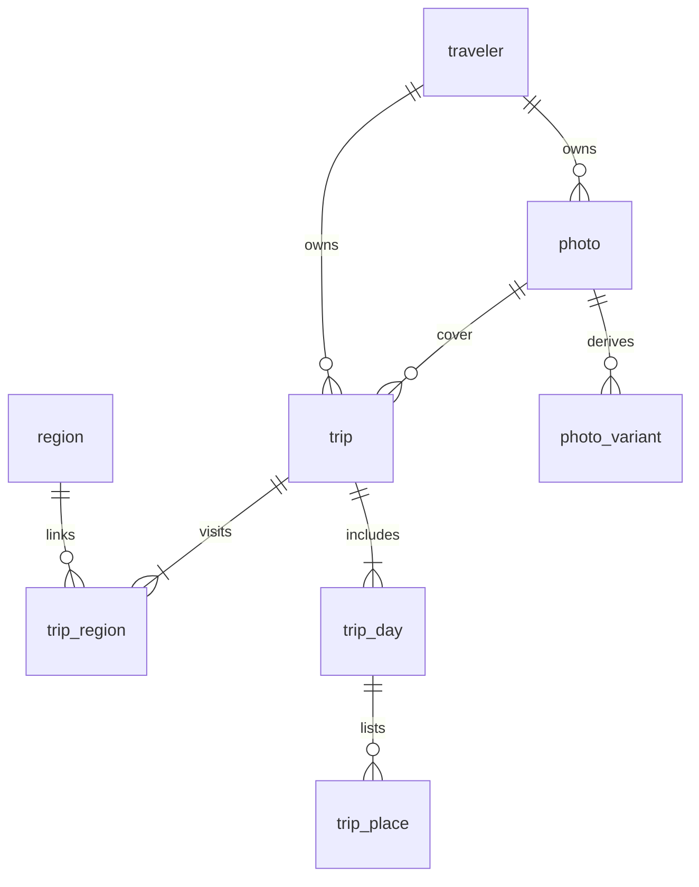

# 사진 중심 데이터베이스 설계

## 저장 전략

**PostgreSQL에는 관계와 사진 메타데이터를, 사진 바이트는 별도 파일 저장소에 둔다.** PostgreSQL BLOB이나 base64 컬럼에 사진을 쌓지 않는다. DB 백업과 사진 용량 증가를 분리하고 향후 CDN·이미지 변환을 독립 확장하기 위한 선택이다.

개발 구현은 로컬 디스크, 운영 설계는 비공개 S3 또는 호환 오브젝트 스토리지다. 공급자는 아직 확정하지 않았다. 미디어 폴더와 DB를 각각 영속 볼륨으로 유지해야 한다.

## ERD

| 테이블 | 책임과 핵심 필드 |
|---|---|
| traveler | UUID, 세션 토큰 해시, 아이디·표시 이름·BCrypt 비밀번호·복구 코드 해시, 로그인 실패 잠금, 생성 시각 |
| region | 내부 지역 코드, 이름, 지도 키, 정적 추천/소개 |
| trip | 소유자, 대표 지역, 대표 사진, 시작·종료 DATE, 동행인, 멱등 요청 키 |
| trip_region | 여행 ID + 지역 ID, 여행 중 방문 순서(0~9) |
| trip_day | 여행 ID + DAY 번호 복합 키 |
| trip_place | 여행 ID + DAY 번호 + 순번, 장소명, 선택적 장소 사진 ID·위도·경도·주소·OpenStreetMap 출처 ID, 소유자 ID |
| photo | 소유자, object_key, MIME, 바이트, 가로·세로, 처리 상태 |
| photo_variant | 사진 ID + THUMBNAIL/DISPLAY, 파생 파일 키와 크기. 현재는 업로드 때 THUMBNAIL만 만든다 |

지역은 `province`, `district`, `neighborhood` 3단계 계층으로 저장한다. 시·도는 기존 2자리 내부 코드, 시·군·구는 5자리 경계 코드, 읍·면·동은 10자리 행정동 코드를 사용하며 `parent_id`로 바로 위 단계에 연결한다. V7은 기존 키를 보존하면서 지역 외래 키를 10자리로 확장하고 2026-03-25 시행본 행정 읍·면·동 3,627개를 추가한다.

실행 가능한 정의: `backend/src/main/resources/db/migration/V1__travel_schema.sql`부터 `V7__neighborhood_regions.sql`까지다. V5는 기존 `trip.region_id`를 `trip_region`의 첫 지역으로 이관하고, 이후 한 여행에 최대 10개 지역을 순서대로 연결한다. V6는 장소에 선택적 좌표·주소·출처 식별자를 추가하고 좌표 쌍과 범위를 제약한다. V7은 읍·면·동 계층과 10자리 지역 키를 추가한다. 아이디는 대소문자를 구분하지 않는 고유 인덱스, 복구 코드 해시는 고유 인덱스로 보호한다. 익명 traveler 행은 계정 필수화 이전 세션의 가입 시 기록 승계를 위해 남기며, 새 익명 행은 더 이상 만들지 않는다. 로그인 잠금 여부는 DB 시각 기준(`locked_until > now()`)으로 판단한다. 장소 사진은 기존 `photo` 저장소를 재사용하며 `(photo_id, owner_id)` 복합 외래 키로 타인 사진 연결을 막는다. 한 장소에는 현재 사진 한 장을 연결할 수 있다.

## 무결성과 조회

- 대표 사진 소유자와 여행 소유자는 복합 FK로 일치시킨다.
- 지역·사진 없는 여행, 시작일보다 이른 종료일, 빈 장소명, 음수 순서는 DB에서 거부한다.
- DAY 번호가 기간 내인지와 전체 DAY 수 일치는 API에서 검증한다.
- 방문 상태는 `trip_region` 연결에서 파생하며 region에 사용자 방문 여부를 저장하지 않는다.
- `(owner_id, region_id, start_date DESC, created_at DESC)` 인덱스로 지역별 최근 기록을 조회한다.
- `(owner_id, created_at DESC, id)`는 향후 cursor 조회용이다.
- 미참조 정리는 `(status, created_at)`와 trip의 cover_photo_id 인덱스를 사용한다.
- 기록 삭제는 트랜잭션 안에서 소유자를 확인하고 연결 사진 후보를 수집한다. 삭제 후 다른 기록·장소가 참조하지 않는 사진 행과 variant만 제거하며 저장소 파일은 커밋 뒤 최선 노력으로 정리한다.
- 계정 삭제는 소유자의 photo와 photo_variant 파일 키를 함께 모은 뒤 행을 지우고(variant 행은 FK cascade), 커밋 뒤 원본과 썸네일 파일을 지운다.
- 통계: `trip_region`의 고유 지역 수, `trip` 수, `sum(end_date - start_date + 1)`을 각각 계산해 다중 지역 때문에 여행 횟수·일수가 중복되지 않게 한다.
- timestamps는 TIMESTAMPTZ, 여행 날짜는 DATE. 사용자 화면은 날짜를 시간대로 변환하지 않는다.

현재 API는 MVP 전체 목록을 반환한다. 기록량이 커지면 먼저 cursor 페이지네이션과 DAY 일괄 조회를 도입한다. 사진이 많다는 이유만으로 DB 샤딩·파티셔닝을 시작하지 않는다.

## 썸네일 — 구현

지도와 기록 카드가 2048px 원본을 내려받지 않도록 2026-10-19에 THUMBNAIL 변형을 실제로 쓰기 시작했다. 스키마 변경은 없다(V1의 `photo_variant`).

- `POST /api/photos`는 원본을 재인코딩한 뒤 같은 요청 안에서 긴 변 320px 썸네일을 만든다. 원본이 더 작으면 늘리지 않고 같은 크기로 둔다. photo와 photo_variant 행은 한 트랜잭션으로 저장하고, 실패하면 두 파일을 모두 지운다.
- 키는 `{owner}/{photo}-thumbnail.{jpeg|png}`이다. 원본과 같은 형식으로 저장하므로 조회 때 `photo.content_type`을 같이 쓴다. 웹은 항상 JPEG를 올리고, 다른 클라이언트의 PNG는 투명도를 유지한다.
- 축소는 절반씩 단계적으로 줄이며 bilinear 보간을 쓴다. 2048→320을 한 번에 줄이면 보간이 픽셀을 건너뛰어 계단 현상이 생긴다. 측정 예: 2048×1536 JPEG 원본 84.7KB → 썸네일 320×240 5.7KB.
- `GET /api/photos/{id}/thumbnail`은 원본 조회와 같은 소유자 검사와 캐시 헤더(`private, immutable`, 1년, `Vary: Cookie`)를 쓴다. 변형 행이 없는 이전 사진은 같은 주소로 원본 파일을 돌려준다. 나중에 백필로 썸네일을 만들어도 이미 캐시한 브라우저는 같은 사진의 큰 파일을 계속 쓸 수 있다. 내용은 같고 전송량만 다르므로 허용한다. 기존 사진의 백필은 하지 않았다.
- 기록 조회 응답의 `thumbnailUrl`은 지도 채우기·핀과 기록 카드가 쓰고, 지역 화면·상세 화면의 대표 사진은 원본 `photoUrl`을 쓴다. 상세 화면의 31px 장소 사진 칸은 `placePhotoThumbnailUrls`를 쓴다. `placePhotoUrls`는 원본 주소로 남겨 두는데, 기록 수정 폼이 이 주소의 마지막 부분을 사진 ID로 다시 보내기 때문이다.
- 체험 모드는 IndexedDB 레코드에 `thumbnail` Blob(긴 변 320px JPEG, 품질 0.82)과 장소별 `placeThumbnails` Blob을 함께 저장한다. 서버와 같이 브라우저에서 준비한 2048px 사진으로 만든다. 썸네일이 없는 이전 레코드는 원본을 쓰고, 사진을 바꾸지 않고 수정·저장하면 그때 썸네일을 만든다. 수정 폼에서 장소를 지우거나 옮겨도 남은 장소 사진의 썸네일은 사진 주소로 찾아 그대로 옮긴다. 선택 필드를 추가했을 뿐이라 IndexedDB 버전은 올리지 않았다.

## 대량 사진 운영 흐름 — 설계, 미구현

1. 클라이언트가 업로드 세션 생성 요청. 서버는 소유자·총량·확장자·요청 크기를 검증하고 UPLOADING photo를 생성한다.
2. 서버가 임의 UUID 기반 키와 5분 만료 서명 업로드 URL을 발급한다. `quarantine/{owner}/{photo}/source`를 사용하며 사용자 파일명은 키로 쓰지 않는다.
3. 브라우저가 직접 저장소로 전송. 서버를 통과하는 사진 트래픽을 줄인다. 업로드 정책으로 용량을 제한한다.
4. 완료 요청을 받은 서버가 실제 저장 객체의 크기·체크섬을 확인한다. 클라이언트의 성공 주장만 믿지 않는다.
5. 처리 워커가 포맷·픽셀 수·디코딩을 검증하고 EXIF 방향을 반영한 뒤 위치정보를 제거한다. 별도의 불변 최종 키에 안전한 이미지를 생성한다. 서명 URL의 재사용으로 검증 후 원본이 바뀌는 문제를 막는다.
6. THUMBNAIL은 긴 변 320px, DISPLAY는 1600px로 축소한다. 원본 확대는 별도 동작으로만 제공한다. 작은 이미지를 확대하지 않는다. 현재 THUMBNAIL은 업로드 요청 안에서 동기로 만들며, 워커 도입 시 이 단계로 옮긴다.
7. 파생 파일 메타데이터를 저장하고 photo를 READY로 전환한다. READY만 대표 사진으로 연결한다.
8. 지도·목록은 썸네일, 상세는 DISPLAY를 읽는다. 비공개 다운로드 서명/인증된 CDN을 사용한다. 만료 URL 자체를 DB에 저장하지 않는다.

업로드 재시도 키, 워커 재처리와 완료 호출은 멱등 처리한다. 전송 중 중단된 multipart는 저장소 lifecycle로 정리한다. 처리 실패는 FAILED, 삭제 대상은 DELETING으로 표시한다. 저장소 오류 시 READY로 잘못 전환하지 않는다.

## 보관과 복구 — 운영 전 필요

- 사진 메타데이터·파일 참조의 DB 커밋과 저장소 쓰기는 분산 트랜잭션이 아니므로 outbox/재시도 작업으로 최종 일치시킨다.
- 업로드 후 24시간 이상 지나고 어떤 기록도 참조하지 않는 사진만 정리 후보로 선정한다. 삭제 직전 참조를 다시 검사하고 활성 업로드는 제외한다.
- 중복 사진 절약은 실제 필요 확인 후 소유자 범위 체크섬으로 도입한다. 전 사용자 간 해시 조회로 타인의 사진 존재를 노출하지 않는다.
- PostgreSQL 정기 백업 + PITR, 스토리지 버전 관리 + lifecycle. 복구 시험에서 DB와 객체가 모두 복원되는지 확인한다.
- 모니터링: 업로드 실패율, 처리 지연, 미참조 파일 수, 저장 총량, 월 전송량, 썸네일 캐시 적중률.
- 용량 예시(가정): 원본 5MB × 10만 장 ≈ 500GB. 썸네일 50KB × 10만 장 ≈ 5GB. 실제 평균·복제·버전 수·전송량에 따라 달라진다. 대량 지도 로딩에는 썸네일이 필수다.

참고: [AWS S3 서명 업로드](https://docs.aws.amazon.com/AmazonS3/latest/userguide/PresignedUrlUploadObject.html). 서명 URL로 같은 키를 재업로드하면 덮어쓸 수 있으므로 검증 완료 파일은 별도 키로 고정한다.
